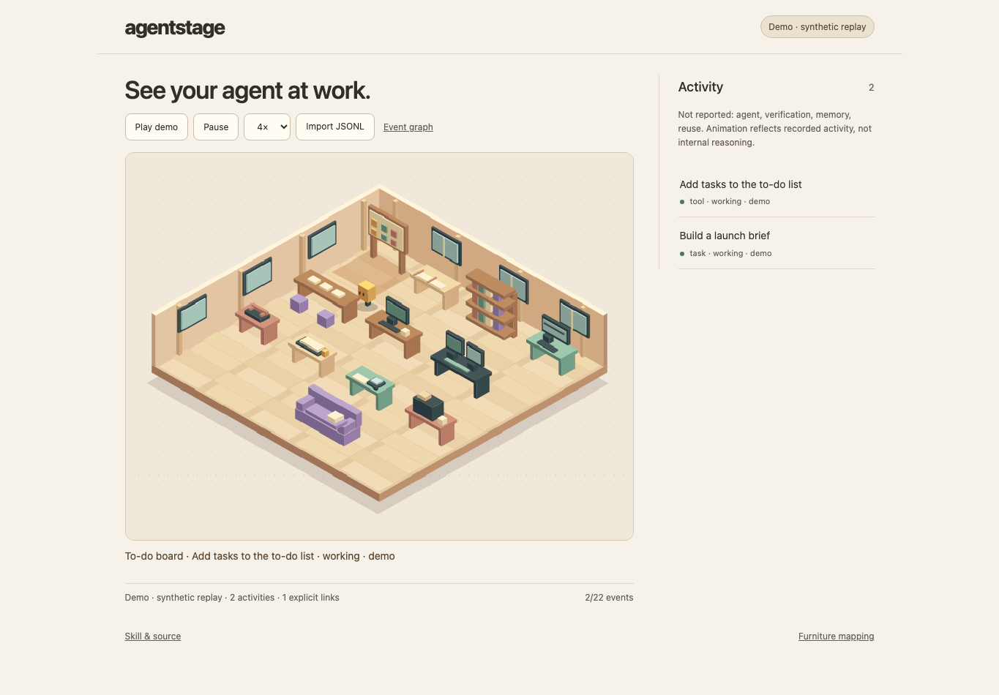

# Agent Stage

**See what your agent is doing.** Agent Stage is an open-source tool and Skill that turns runtime events into an animated room. Watch your agent add a to-do, open the web, consult project notes, hand off a decision or file a memory.

Agent Stage 是独立的开源工具和 Skill。它把 Agent 已暴露的运行事件变成一个正交投影房间里的动作，能实时查看，也能回放。

[Play the animated demo](https://sunnysunnyomg.github.io/agent-stage/?demo=1) · [Open the event graph](https://sunnysunnyomg.github.io/agent-stage/?demo=1&view=graph) · [Read the Skill](skills/agent-stage/SKILL.md)

The Skill discovers your harness’s available events, creates a small adapter and launches the bundled viewer. The room, event graph, demo and static export run with no external assets, vendor SDK or model API.

## Install the Skill

```sh
npx --yes skills@1.7.4 add https://github.com/SunnySunnyOMG/agent-stage/tree/v0.3.0 --skill agent-stage --copy
```

The optional installer requires Node.js 22.20.0+ and npm. Select your host and installation scope; review the printed destinations. Or copy the complete `skills/agent-stage/` folder into your host's documented Skills directory. Discovery and invocation depend on the host; installing a directory does not establish a live connection.

Then ask your agent:

> 使用 agent-stage，检查当前 Harness 暴露的运行事件，为我搭建一个能查看运行过程的网页。复用附带的动画引擎，实际验证接入；没有暴露的能力保持未知。如果当前环境支持部署，就把页面部署到我能打开的网址。

Use your host's invocation syntax, for example `$agent-stage` in Codex. No provider-specific SDK or extra model API is required by this package. The host still needs access to a documented event source and the tools required for its chosen deployment.

## Try the engine

Clone or download this repository. **Node.js 20+** runs the bundled viewer with no dependency installation.

```sh
npm run demo
```

Open the printed URL. The default studio shows the synthetic replay moving between 12 stations. Select **Event graph** for a second synthetic scenario showing delegation, tool retry and explicit parent relationships.

[See the complete furniture mapping](skills/agent-stage/references/events.md#furniture-mapping).



For a source adapted to the [normalized JSONL contract](skills/agent-stage/references/events.md):

```sh
node skills/agent-stage/scripts/serve.mjs --events ./normalized-events.jsonl
```

For a static site you can deploy with your own hosting tools:

```sh
node skills/agent-stage/scripts/export.mjs --out ./agent-stage-web
```

The export supports demo replay and browser-local JSONL import. It does not copy your live event file. Remote live observation needs an explicitly configured bridge; a static website cannot read another computer's local logs.

## A small engine, behind the Skill

```text
Harness / hooks / callbacks / logs
                 │
          a thin adapter
                 │
       normalized event stream
                 │
          observed state
                 │
      director → studio or event graph
                 │
         webpage / replay
```

- **Source:** documented events determine which capabilities exist.
- **State:** deduplicate events, respect ordering and keep runs separate.
- **Director:** choose what to focus on and how motion connects.
- **Renderer:** draw the orthographic room and activity cues, or show recorded relationships in the graph.

Only explicit parent relationships create links. Concurrent tool calls do not invent subagents. A successful tool does not prove task acceptance or memory persistence. Disconnects preserve the last observed state and show incomplete observation. `observed`, `reported` and `demo` remain distinguishable.

The browser template can be restyled or replaced while keeping the same event contract. Animation is a view; it never schedules or approves agent work.

## Release scope

This release includes a self-contained browser engine and a Skill for creating an adapter from the events your harness provides.

- Bundled: Skill, event contract, animated studio, event graph, synthetic replays, loopback JSONL server and static export.
- Checked: event reduction, transport, station routing, confirmed idle, and static export. See [validation](docs/VALIDATION.md).
- Not established: universal host compatibility, production throughput, native desktop subscriptions or a hosted multi-user collector.

The collector exposes only short display fields and binds to loopback. Adapter authors must redact labels and review any data they choose to publish. Raw prompts, arguments, conversation text and credentials are outside the display contract.

## Develop

```sh
npm test
```

Read [the Skill](skills/agent-stage/SKILL.md), [design](docs/DESIGN.md) and [event contract](skills/agent-stage/references/events.md). Contributions are most useful as small real harness examples with a field mapping, supported/missing capabilities and observable verification.

MIT licensed. No account, model call or vendor service is needed to run the included demo.
