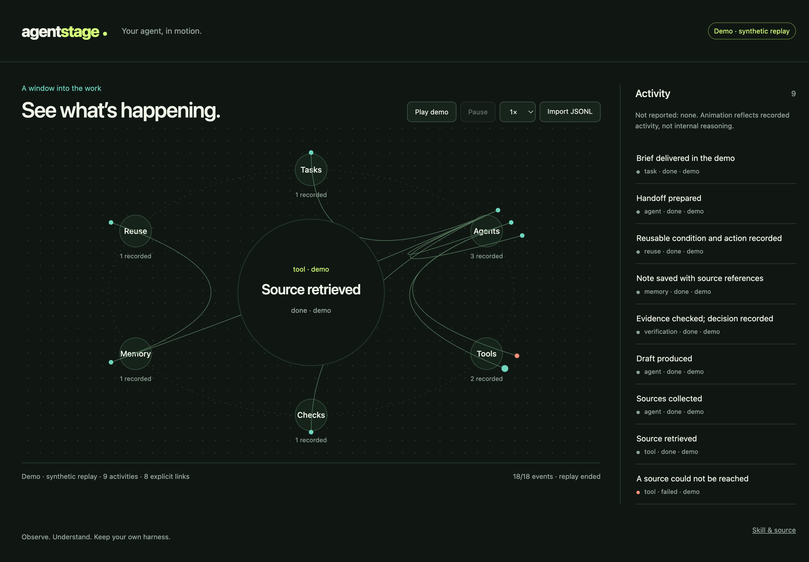

# Agent Stage

**Give your agent a stage.** A portable Skill that helps your current agent build a webpage showing what its harness actually exposes.

一个通用 Skill，让 Agent 在自己的 Harness 里搭建运行可视化网页。任务、工具调用、分工、等待与记忆操作，通过事件变成可以观察的动画。

**视频里的 Ori 办公室**使用本地 AIBox 的动画引擎。接入事件后，普通工作出现在电脑桌前，检索去图书馆，确认空闲后去泡咖啡和休息。[运行 Ori 办公室](#ori-office-with-a-local-aibox-checkout)

[Public graph demo](https://sunnysunnyomg.github.io/agent-stage/?demo=1) · [Read the Skill](skills/agent-stage/SKILL.md)

The Skill discovers the available protocol, builds a thin adapter and reuses a small browser animation engine. Keep your own harness. Change the adapter when the event source changes.

## Install the Skill

```sh
npx --yes skills@1.7.4 add https://github.com/SunnySunnyOMG/agent-stage/tree/v0.2.0 --skill agent-stage --copy
```

The optional installer requires Node.js 22.20.0+ and npm. Select your host and installation scope; review the printed destinations. Or copy the complete `skills/agent-stage/` folder into your host's documented Skills directory. Discovery and invocation depend on the host; installing a directory does not establish a live connection.

Then ask your agent:

> 使用 agent-stage，检查当前 Harness 暴露的运行事件，为我搭建一个能查看运行过程的网页。复用附带的动画引擎，实际验证接入；没有暴露的能力保持未知。如果当前环境支持部署，就把页面部署到我能打开的网址。

Use your host's invocation syntax, for example `$agent-stage` in Codex. No provider-specific SDK or extra model API is required by this package. The host still needs access to a documented event source and the tools required for its chosen deployment.

## Try the engine

### Ori office with a local AIBox checkout

Clone Agent Stage and run these commands from the repository root. The export uses the supplied AIBox checkout and its installed `esbuild` to build Ori's Canvas stage, director, and sprite atlas locally.

```sh
node skills/agent-stage/scripts/export.mjs --ori-source /path/to/aibox --out ./agent-stage-web
node skills/agent-stage/scripts/serve.mjs --web ./agent-stage-web --demo
```

Open the printed URL to play the office replay. For a live local source, replace `--demo` with `--events ./normalized-events.jsonl`.

| Event or state | Ori's action |
| --- | --- |
| Working with `intent: "research"` | Walks to the library and reads. |
| General work, including observable model activity | Works at the computer. |
| Memory operation | Uses the library's filing motion. |
| Needs the user | Goes to the handoff desk. |
| Root task has ended and the source confirms there is no active work | Makes coffee and rests on the sofa. |

For example, a source can mark a search operation as `"kind":"tool","state":"working","intent":"research"`. The [event contract](skills/agent-stage/references/events.md) shows the full record. The generated Ori directory includes code and assets from the supplied AIBox checkout. Public redistribution of that directory depends on their license.

### Standalone graph demo

Clone or download this repository. The included helper needs **Node.js 20+**, with no dependency installation:

```sh
npm run demo
```

Open the printed URL. The demo is a **synthetic replay**, covering delegation, a failed tool and retry, a human decision, verification, memory and reuse. It is not a live agent connection.



For a source adapted to the [normalized JSONL contract](skills/agent-stage/references/events.md):

```sh
node skills/agent-stage/scripts/serve.mjs --events ./normalized-events.jsonl
```

For a static site you can deploy with your own hosting tools:

```sh
node skills/agent-stage/scripts/export.mjs --out ./agent-stage-web
```

The export supports demo replay and browser-local JSONL import. It does not copy your live event file. Remote live observation needs an explicitly configured bridge; a static website cannot read another computer's local logs.

## A small engine, behind the Skill

```text
Harness / hooks / callbacks / logs
                 │
          a thin adapter
                 │
       normalized event stream
                 │
          observed state
                 │
      director → animation frame
                 │
         webpage / replay
```

- **Source:** documented events determine which capabilities exist.
- **State:** deduplicate events, respect ordering and keep runs separate.
- **Director:** choose what to focus on and how motion connects.
- **Renderer:** draw the graph, activity and recorded relationships.

Only explicit parent relationships create links. Concurrent tool calls do not invent subagents. A successful tool does not prove task acceptance or memory persistence. Disconnects preserve the last observed state and show incomplete observation. `observed`, `reported` and `demo` remain distinguishable.

The browser template can be restyled or replaced while keeping the same event contract. Animation is a view; it never schedules or approves agent work.

## Release scope

This is a **Skill-first starter with a minimal working engine**, not a full monitoring product or a collection of certified native adapters. The Skill guides your agent to create an adapter for the protocol its current harness provides.

- Bundled: Skill, integration/deployment references, normalized contract, browser engine, synthetic replay, loopback JSONL server, static export and the optional Ori adapter.
- Checked: reducer and transport behavior, browser replay, responsive layout, a custom-harness fixture integration, and the local Ori export. See [validation](docs/VALIDATION.md).
- Not established: universal host compatibility, production throughput, native desktop subscriptions or a hosted multi-user collector.

The collector exposes only short display fields and binds to loopback. Adapter authors must redact labels and review any data they choose to publish. Raw prompts, arguments, conversation text and credentials are outside the display contract.

## Develop

```sh
npm test
```

Read [the Skill](skills/agent-stage/SKILL.md), [design](docs/DESIGN.md) and [event contract](skills/agent-stage/references/events.md). Contributions are most useful as small real harness examples with a field mapping, supported/missing capabilities and observable verification.

MIT licensed. No account, model call or vendor service is needed to run the included demo.
